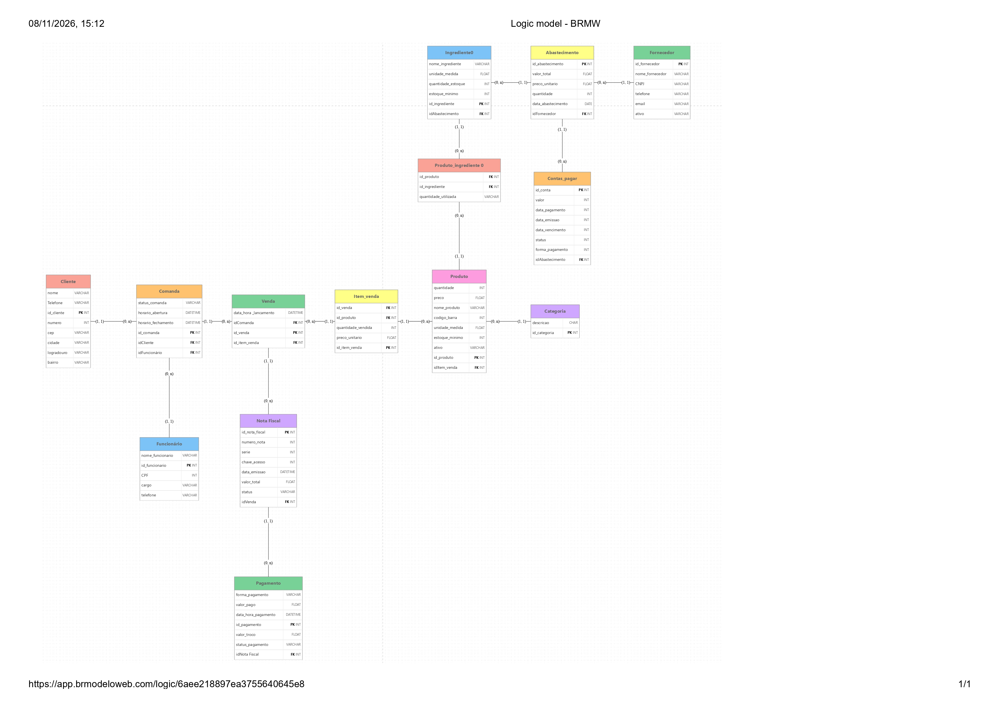

## 1\. Padaria Forno Lusitano

### Integrantes

| Nome completo do aluno | RGM | Usuário do GitHub |
| :---- | :---- | :---- |
| Alex Christini dos Santos | 47919833 | vitoriachristini2019-oss |
| Carolina Ayumi Kawakami Faria | 47927470| carolinaayumi02-stack |
| Lucas Oliveira da Silva| 48323667| LucasoliveiraSG|
| Lucas Silva de Morais| 48040843 | lucasmoraisstory |

&nbsp;

### 1.1 Revisão do Modelo Conceitual

**Caracterização da organização (todos os grupos)**

- **Nome e natureza da organização:** O objeto de estudo selecionado para esta modelagem relacional é a **Forno Lusitano**, uma empresa de pequeno/médio porte pertencente ao setor de alimentação e gastronomia, operando sob o regime de fins lucrativos. Localizada estrategicamente no bairro Lajeado, a instituição acumula funções híbridas de panificadora, confeitaria e restaurante na modalidade de *self-service*. Para assegurar a eficiência no atendimento ao público, o estabelecimento possui o espaço físico compartimentado em setores funcionais bem delimitados, compreendendo: área de copa, balcão de bebidas, seção especializada de pães e doces, e o setor de laticínios e frios.
- **Contexto e porte:** A operação comercial ocorre de forma intensiva e contínua, funcionando de segunda a segunda, das 07:00h às 22:00h. Para suportar essa jornada de alta demanda, a empresa conta com um quadro efetivo de 25 colaboradores distribuídos em turnos de revezamento. O fluxo de clientes é expressivo, registrando uma circulação diária estimada entre 500 pessoas, das quais aproximadamente 350 realizam consumo ou aquisição direta de produtos, gerando um volume considerável de transações diárias.
- **Problemas e necessidades identificados:** Conforme levantamento realizado no local por meio de entrevista com o gerente operacional (Sr. Severino), a organização padece de limitações estruturais em seus fluxos de informação. O processo de atendimento utiliza primariamente comandas físicas para o registro de consumo, sendo os acertos consolidados e liquidados manualmente no caixa ao término do atendimento. A escassez crônica de mão de obra — evidenciada por jornadas exaustivas e momentos em que o próprio gerente precisa acumular funções de atendimento no balcão — resulta em forte gargalo operacional. A dependência de registros em papel e planilhas descentralizadas compromete a integridade e a rastreabilidade dos dados, abrindo margem para inconsistências no controle de estoque, dificuldades na apuração gerencial de faturamento e sobrecarga humana decorrente da ausência de automação transacional.
- **Justificativa da escolha:** A Forno Lusitano revelou-se um caso de estudo ideal para a engenharia de dados devido à complexidade inerente ao seu modelo de negócio misto (varejo de balcão e serviço de alimentação). O ecossistema transacional — que envolve gestão de múltiplos setores de produtos, controle rigoroso de comandas individuais, fechamento de caixa e dimensionamento de fluxo de clientes — fornece a massa crítica e a diversidade relacional necessárias para justificar a construção de um banco de dados relacional robusto, escalável e normalizado.
- **Evidências da organização:** 

  -  **Localização:** 
  Estr. do Lageado Velho, 1012 - Guaianases, São Paulo - SP, 08451-000
  - **Fontes de Dados Primárias (Pesquisa de Campo):** Entrevista semiestruturada conduzida presencialmente com o gerente responsável, Sr. Severino.
  - **Telefone:** 
  (11) 91858-4285
  - **Instagram:**  https://www.instagram.com/padarialusitano/
  - **Registros da visita:**
  - [`registro da visita.`](comprovante_visita.jpeg)

**Quem**
- **Entrevistado:** Severino (Gerente da Padaria Forno Lusitano)
- **Integrantes Participantes:** Alex (Vitória) Christini dos Santos e Lucas Oliveira da Silva

**Quando e Onde (Observação no Local)**
- **Data e Local:** Entrevista realizada presencialmente nas dependências da **Padaria Forno Lusitano**, durante o horário de atendimento da equipe.
- **Achados da Observação Presencial vs. Respostas:**
  - *O que foi dito:* O gerente explicou a rotina geral de atendimento, fluxo de comandas e divisão dos turnos dos colaboradores.
  - *O que foi observado:* A equipe presenciou o alto movimento no balcão e no buffet de almoço self-service, a dependência de anotações manuais em blocos de papel para controle interno secundário, e a agilidade necessária no leitor de código de barras das comandas para evitar filas no caixa.

**O Que Foi Levantado**
O levantamento de requisitos mapeou os processos operacionais, regras de negócio, volumetria diária e os gargalos do estabelecimento.

**Documento Completo:** [Acesse o Relatório de Levantamento Detalhado](/Levantamento/levantamento.md)

### Processos de negócio (todos os grupos)

Nesta seção, descrevem-se os principais fluxos operacionais mapeados na rotina da **Forno Lusitano**, os quais servem como base empírica para a modelagem relacional do banco de dados:

1. **Atendimento e Gestão de Comanda:**
   Processo central de atendimento no salão e balcão. Ao ingressar no estabelecimento, o cliente recebe uma comanda física numerada. A equipe de atendimento anota manualmente todos os itens consumidos (seja na seção de pães e doces, balcão de bebidas, frios ou restaurante *self-service*). A comanda atua como o documento transacional primário que acompanha o cliente até o acerto final.

2. **Controle de Acesso pela Comanda:**
   Mecanismo de controle físico e operacional que regula o fluxo de circulação. A comanda numerada serve como credencial de permanência no salão, sendo exigida obrigatoriamente para a liberação da saída do cliente nas catracas ou portas, atestando que o ciclo de atendimento foi devidamente finalizado.

3. **Abertura e Operação do Caixa:**
   Rotina financeira diária que compreende a inicialização do terminal com o fundo de troco, o registro contínuo das vendas e o fechamento/conciliação ao término do expediente. O operador de caixa recolhe a comanda física, valida os registros, calcula o montante devido e efetua a liquidação financeira (em dinheiro, cartão ou PIX), encerrando o ciclo de venda.

4. **Cadastro de Produtos no Sistema:**
   Processo administrativo e logístico para inserção e atualização do catálogo de mercadorias da padaria e restaurante. Cada item recebe uma descrição, categoria e um código de identificação, permitindo tanto a digitação manual quanto o escaneamento rápido no momento do registro do consumo.

5. **Controle de Estoque:**
   Rotina de gerenciamento e verificação periódica dos insumos e produtos prontos estocados nos diferentes setores (copa, bebidas, pães, doces e laticínios). O processo visa monitorar a disponibilidade de mercadorias para assegurar o abastecimento contínuo e evitar rupturas durante as 15 horas diárias de funcionamento (das 07:00h às 22:00h).

6. **Cadastro de Clientes para Entregas:**
   Processo voltado para o atendimento na modalidade de *delivery* ou encomendas externas. Quando o cliente solicita um pedido fora do salão, a equipe realiza o registro dos dados cadastrais essenciais: **nome, telefone de contato e endereço completo**, garantindo a rastreabilidade logística e o histórico de atendimento.

7. **Produção própria de pães e doces:**
   Processo operacional realizado na cozinha e na área de panificação, responsável por transformar insumos em produtos prontos para venda. A produção segue receitas padronizadas que definem os ingredientes e as quantidades necessárias para cada item. A equipe registra o que foi produzido, a quantidade e a data, e os ingredientes consumidos são baixados do estoque. Os produtos fabricados entram no estoque de pães e doces, ficando disponíveis para o atendimento no salão e no balcão.

8. **Compra de insumos e cadastro de fornecedores:**
   Processo administrativo de reposição de matérias-primas e mercadorias de revenda (farinha, laticínios, frios, bebidas, entre outros). Antes da primeira compra, cada fornecedor é cadastrado com razão social, CNPJ, telefone, e-mail e endereço. A necessidade de compra é identificada a partir do controle de estoque, e o pedido é emitido ao fornecedor com os itens, as quantidades e o valor negociado. O valor da compra gera uma obrigação financeira, registrada em contas a pagar com vencimento e situação de pagamento.

9. **Recebimento da mercadoria:**
   Rotina de conferência das entregas realizadas pelos fornecedores. No ato da entrega, o responsável compara os itens recebidos com o pedido de compra e a nota fiscal do fornecedor, verificando quantidade, qualidade, temperatura (quando aplicável) e prazo de validade. Mercadorias conformes são lançadas no estoque, e divergências ou avarias são registradas para devolução ou reclamação. Esse processo liga o pedido de compra à entrada efetiva de produtos no estoque.

10. **Escala de turnos dos 25 colaboradores:**
   Processo de gestão de pessoal que organiza a jornada dos 25 colaboradores de modo a cobrir as 15 horas diárias de funcionamento (07:00h às 22:00h). A escala define, para cada colaborador, o setor (atendimento, caixa, cozinha, panificação, limpeza), o dia, o turno e o horário de entrada e saída. Ela é elaborada previamente, considerando folgas e a demanda de cada período, e permite identificar quem estava responsável por cada setor em determinado horário.

11. **Controle de validade e perdas:**
   Rotina de verificação periódica das datas de validade dos produtos e insumos estocados, com atenção especial aos perecíveis (laticínios, frios, pães e doces). Itens vencidos, danificados ou produzidos em excesso e não vendidos são retirados de circulação e registrados como perda, com produto, quantidade, data e motivo. Esse registro dá baixa no estoque e fornece dados para ajustar compras e produção, reduzindo o desperdício.

### Requisitos (todos os grupos)

### Requisitos Funcionais
- **RF01- Cadastrar o cliente:** O sistema deve permitir que haja o cadastro de informações dos clientes, com CPF, endereço, nome. 
- **RF02- Cadastrar produtos:** O sistema deve permitir que haja o cadastro dos produtos com informações dos preços, quantidade e categoria. 
- **RF03- Verificar o estoque:** O sistema deve notificar quando um produto chega a sua quantidade mínima. 
- **RF04- Alterar produtos**- O sistema deve permitir a alteração de preços e quantidade dos produtos.
- **RF05- Registrar comandas**- O sistema deve conter o registro de produtos em comandas.  
- **RF06- Registrar vendas**- O sistema deve permitir que sejam geradas as informações da compra e recibos comprovados.  

### Requisitos Não Funcionais
- **RFN01- Desempenho:** O sistema deve apresentar um tempo de resposta rápido e garantir que funcione sob uma larga escala de usuários dentro do sistema. 
- **RFN02- Usabilidade:** O sistema deve garantir que sua interface seja clara e objetiva a quem utiliza.
- **RFN03- Segurança:** O sistema deve garantir a criptografia das informações para proteger a privacidade dos consumidores. 
- **RFN04- Portabilidade:** O sistema deve ser compatível com o navegador utilizado. 
- **RFN05- Disponibilidade:** O sistema deve funcionar em horários comerciais e em caso de manutenções exibir informações prévias aos usuários. 

### Regras de negócio (todos os grupos)

- **Regras operacionais:** 

 - RN01: Cliente só circula no salão com a comanda numerada; a saída só é liberada após o pagamento.
 - RN02: Caixa só é aberto por funcionário autorizado, com registro do fundo de troco.
 - RN03: Caixa só é fechado sem comandas abertas pendentes; o fechamento exige conciliação do valor apurado.
 - RN04: Todo consumo é registrado no sistema; a comanda só é encerrada no momento do pagamento.
 - RN05: Produto só é lançado se estiver cadastrado, e só é vendido se houver saldo suficiente em estoque.
 - RN06: Comanda só é liberada para novo cliente após o pagamento total dos itens.
 - RN07: Perda da comanda gera multa, registrada com motivo e funcionário responsável.
 - RN08: No self-service, o valor é calculado pelo peso líquido multiplicado pelo preço por quilo vigente.
 - RN09: Delivery só atende endereços dentro do raio definido, com cobrança de taxa de entrega.
 - RN10: Produto vencido ou avariado é descartado, registrado como perda e baixado do estoque.
 - RN11: Manipulação de alimentos segue as normas sanitárias (higiene, temperatura e rastreio de lotes).
 - RN12: Toda venda paga gera cupom fiscal, com CPF na nota somente se o cliente solicitar.
 - RN13: CPF e endereço de clientes são tratados conforme a LGPD, com finalidade definida e acesso restrito.
 - RN14: Compra recebida gera conta a pagar com vencimento não anterior à emissão.
 - RN15: estoque no mínimo entra na lista de reposição.
 - RN16: nota fiscal emitida não é excluída, apenas cancelada.
---

| Apontamento da correção da E1 | O que mudou no trabalho | Por quê |
| :---- | :---- | :---- |
| Ausência da entidade `fornecedor` no DER | foi adicionada a entidade `fornecedor` com atributos de `id`, `nome`, `telefone`, `CNPJ`,`email`, `ativo`. | Sem ela não é possvel identificar quem abastece o local e nem ter informações de contato. |
| Dissolvida a tabela `pedido` | Foi adicionada a entidade associativa `venda` com atributos de `data_hora_lancamento`, `subtotal`,`preco_unitario` e `quantidade_vendida`. | Foi adicionada a entidade associativa como forma de resolver relacionamentos (N:N) |
|Ausência da Regra de Negócio "Multa por perda de comanda"|Foi adicionada a Regra de Negócio que estabelece a multa por perda de comanda `RN07`| Foi adicionada pois ao perder a comanda não é possível identificar oque o cliente consumiu, portanto a multa cobra o prejuízo.
|Ausência da Regra de Negócio "Preço por quilo do Self-Service"| Foi adicionada a Regra de Negócio que estabelece o preço por quilo do Self-Service `RN08`| Foi adicionada pois o valor da refeição depende do pesodo prato, o preço por quilo garante uma cobrança proporcional.
|Ausência da Regra de Negócio "Taxa e raio de entrega"|Foi adicionada a Regra de Negócio que estabelece a taxa e raio da entrega `RN09`| Foi adicionada pois delimita até onde a padaria consegue atender. 
|Ausência da Regra de Negócio "Descarte de produtos vencidos"|Foi adicionada a Regra de Negócio que exige o Descarte de 'produtos' vencidos `RN10`| Foi adicionada pois garante que não há futuras complicações com a vigilância sanitária e proteja a saúde do cliente.
|Ausência da Regra de Negócio "Normas sanitárias"|Foi adicionada a Regra de Negócio que estabelece normas sanitárias `RN11`| Foi adicionada pois garante que os alimentos sejam preparadas de forma segura.
|Ausência da Regra de Negócio "Emissão de cupom fiscal"|Foi adicionada a Regra de Negócio que justifica a emissão de cupom fiscal `RN16`|Foi adicionada pois é considerada uma obrigação legal e toda venda precisa ser registrada.
|Ausência da Regra de Negócio "LGPD para CPF e endereço de clientes"|Foi adicionada a Regra de Negócio que estabelece a proteção de dados de CPF e endereço `RN13`|Foi adicionada pois são dados sensíveis de identificação de clientes e devem ser protegidas.

&nbsp;

*Se o grupo discordar de algum apontamento e mantiver o modelo como estava, registre isso na tabela com a justificativa. Apontamento não citado na tabela é tratado como não corrigido.*

**Caso B — nova organização (a da Entrega 1 era fictícia ou não teve a existência comprovada)**

*Além de todos os itens acima, apresente o **DER conceitual** da nova organização, na notação descrita acima.*

*Use a correção da Entrega 1 do grupo como guia dos erros a não repetir, mesmo sendo outra organização.*

### 1.2 Conversão do Modelo Conceitual para o Modelo Lógico

O modelo lógico foi obtido no BRModelo a partir do modelo conceitual da padaria e depois revisado, para que cada atributo, relacionamento e cardinalidade do conceitual tenha correspondência exata em colunas, chaves e tabelas.

O resultado tem **13 tabelas**: as 12 entidades do conceitual (incluindo as associativas `Venda` e `Abastecimento`) mais `Produto_Ingrediente`, que surge da conversão de uma relação N:N.

A conversão seguiu três regras:

- cada atributo vira uma coluna e cada identificador vira chave primária;
- cada relacionamento 1:N vira uma chave estrangeira no lado N;
- cada relacionamento N:N vira uma tabela associativa com duas chaves estrangeiras.

 |Entidade | Tabela |
 | :---- | :----|
 | Cliente | Cliente |
 | Comanda | Comanda |
 | Funcionario | Funcionario |
 | Venda | Venda|
 | Nota fiscal | Nota fiscal |
 | Pagamento | Pagamento |
 | Produto | Produto |
 | Categoria | Categoria |
 | Ingrediente | Ingrediente |
 | Abastecimento | Abastecimento |
 | Conta pagar | Conta pagar |

- **Atributos → Colunas:** 

Todo atributo simples do conceitual virou uma coluna da tabela da sua entidade, e todo atributo identificador virou chave primária (`id_cliente`, `id_comanda`, `id_produto`, `id_nota_fiscal` e assim por diante).

- **Atributo composto:** `endereço`, de Cliente, deixou de existir como coluna e foi decomposto nos atributos que o formam: `cep`, `cidade`, `logradouro`, `bairro` e `numero`.
- **Atributo multivalorado:** o modelo não possui nenhum. Os campos `telefone` e `email` guardam um valor por pessoa, então não geram tabelas extras.
- **Identificador de Abastecimento:** o atributo `estoque_abastecimento` foi renomeado para `id_abastecimento`, seguindo o padrão `id_<entidade>` das demais tabelas.
- **Atributos calculados:** `subtotal`, `valor_total` e `valor_troco` foram convertidos como colunas, e a seção 1.4 trata a sua eliminação.

Os tipos de dados foram escolhidos pelo domínio de cada atributo:

| Tipo | Atributos |
| --- | --- |
| `INT` | chaves primárias e estrangeiras, `quantidade`, `estoque_minimo`, `numero_nota`, `serie` |
| `VARCHAR` | nomes, `telefone`, `email`, `cep`, `CPF`, `CNPJ`, `codigo_barra`, `chave_acesso`, `unidade_medida`, `status` e `forma_pagamento` |
| `DECIMAL(10,2)` | valores monetários: `preco`, `preco_unitario`, `subtotal`, `valor_total`, `valor_pago`, `valor_troco`, `valor` |
| `DATE` e `DATETIME` | datas (`data_abastecimento`, `data_vencimento`) e data com hora (`horario_abertura`, `data_hora_lancamento`) |
| `BOOLEAN` | `ativo` |

`CPF`, `CNPJ`, `codigo_barra` e `chave_acesso` ficam como texto porque são identificadores, não quantidades: podem começar com zero e não entram em cálculos.

- **Relacionamentos → Chaves:** 

Cada relacionamento do conceitual foi traduzido em uma chave estrangeira (FK) que referencia a chave primária da outra tabela. Nos relacionamentos 1:N, a FK fica na tabela do lado N, e a FK tem o mesmo nome da chave primária que referencia.

| Relacionamento | Entidades | Tradução no modelo lógico |
| --- | --- | --- |
| abre | Cliente 1:N Comanda | `Comanda.id_cliente` |
| registra | Funcionário 1:N Comanda | `Comanda.id_funcionario` |
| Venda (associativa) | Comanda 1:N Venda | `Venda.id_comanda` |
| Venda (associativa) | Produto 1:N Venda | `Venda.id_produto` |
| possui | Categoria 1:N Produto | `Produto.id_categoria` (aceita nulo, pois a cardinalidade é (0,1)) |
| gera | Venda 1:1 Nota Fiscal | `Nota_Fiscal.id_venda`, com restrição `UNIQUE` |
| contém | Nota Fiscal 1:N Pagamento | `Pagamento.id_nota_fiscal` |
| contém | Produto N:N Ingrediente | tabela `Produto_Ingrediente` |
| Abastecimento (associativa) | Ingrediente 1:N Abastecimento | `Abastecimento.id_ingrediente` |
| Abastecimento (associativa) | Fornecedor 1:N Abastecimento | `Abastecimento.id_fornecedor` |
| gera | Abastecimento 1:N Contas_pagar | `Contas_pagar.id_abastecimento` |

Nas entidades associativas `Venda` e `Abastecimento`, as duas FKs ficam na própria tabela, e não nas tabelas `Produto` e `Ingrediente`. Um produto aparece em muitas vendas, e um ingrediente é comprado muitas vezes; a FK na tabela de origem limitaria cada um a uma única venda ou compra.

- **Cardinalidades:**

O modelo tem cinco relacionamentos 1:N, um 1:1 e três N:N; cada tipo recebeu um tratamento diferente.

### 1:N

A chave estrangeira fica no lado N: `Comanda` (`id_cliente` e `id_funcionario`), `Produto` (`id_categoria`), `Pagamento` (`id_nota_fiscal`) e `Contas_pagar` (`id_abastecimento`). Quando a participação do lado N é opcional, como em Produto–Categoria (0,1), a FK aceita nulo.

### 1:1

Na relação Venda–Nota Fiscal, a FK `id_venda` fica em `Nota_Fiscal`, que depende da venda para existir. A restrição `UNIQUE` nessa coluna impede mais de uma nota por venda, o que mantém a cardinalidade 1:1.

### N:N

Uma relação N:N não pode ser representada por uma única FK, então cada uma virou uma tabela com duas chaves estrangeiras:

| N:N | Tabela associativa | Chave primária | Chaves estrangeiras | Atributos próprios |
| --- | --- | --- | --- | --- |
| Comanda ↔ Produto | `Venda` | `id_venda` | `id_comanda`, `id_produto` | `data_hora_lancamento`, `quantidade_vendida`, `preco_unitario` |
| Ingrediente ↔ Fornecedor | `Abastecimento` | `id_abastecimento` | `id_ingrediente`, `id_fornecedor` | `quantidade`, `preco_unitario`, `data_abastecimento` |
| Produto ↔ Ingrediente | `Produto_Ingrediente` | `id_produto` + `id_ingrediente` | `id_produto`, `id_ingrediente` | `quantidade_utilizada` |

- **Venda:** cada linha é um item lançado na comanda. A chave própria permite lançar o mesmo produto mais de uma vez na mesma comanda.
- **Abastecimento:** cada linha é uma compra de um ingrediente de um fornecedor.
- **Produto_Ingrediente:** guarda a ficha técnica do produto. A chave primária composta impede repetir o mesmo ingrediente no mesmo produto, e `quantidade_utilizada` registra quanto de cada ingrediente o produto usa.

- **Generalização/especialização:**

O modelo conceitual **não possui** generalização nem especialização: todas as entidades são independentes e nenhuma herda atributos de outra. Por isso não foi necessário escolher uma estratégia de conversão (tabela única, uma tabela por entidade ou apenas as especializadas), e cada entidade virou uma tabela própria.

### 1.3 Definição de Chaves Primárias e Estrangeiras

| Tabela	| Chave primária | Chaves estrangeiras |
| :---- | :---- | :---- |
| Cliente |	`id_cliente` | nenhuma |	
| Categoria | `id_categoria` | nenhuma |	
| Funcionário |	`id_funcionario` | nenhuma |
| Fornecedor | `id_fornecedor` | nenhuma |	
| Ingrediente |	`id_ingrediente` | nenhuma |	
| Comanda |	`id_comanda` | id_cliente → Cliente, id_funcionario → Funcionário |
| Produto |	`id_produto` | id_categoria → Categoria |
| Venda	| `(id_comanda, id_produto)` | id_comanda → Comanda, id_produto → Produto	|
| Nota Fiscal |	`id_nota_fiscal` | id_venda → Venda (1:1, com UNIQUE) |
| Pagamento | `id_pagamento` | id_nota_fiscal → Nota Fiscal |
| Produto_Ingrediente |	`(id_produto, id_ingrediente)` | id_produto → Produto, id_ingrediente → Ingrediente |
| Abastecimento | `id_abastecimento` | id_ingrediente → Ingrediente, id_fornecedor → Fornecedor |
| Contas_pagar | `id_conta` |	id_abastecimento → Abastecimento |

### 1.4 Processo de Normalização (1FN, 2FN e 3FN)
----
### 1FN: Eliminação de grupos repetitivos/atributos multivalorados.
- O atributo composto `endereco` foi separado por colunas `numero`, `CEP`,  `logradouro`,    `cidade`, `bairro`. Sua separação ocorreu pois a inserção dos elementos em novas colunas permite uma consulta mais eficiente e rápida.

### 2FN: Eliminação de dependências parciais.
- Foi criada a tabela `item_venda` com atributos: `id_venda`, `id_produto`, `quantidade_vendida`, `preco_unitario` e `id_item_venda`. A criação ocorreu para que em sua tabela uma venda possa conter vários produtos.

- Foi criada a tabela `produto_ingrediente` com atributos: `id_produto`,`ìd_ingrediente` e `quantidade_utilizada`. A criação ocorreu pela possibilidade de um produto conter vários ingredientes diferentes.

### 3FN: Eliminação de dependências transitivas.
- Não foi identificado elementos que estivessem fora da 3FN

### 1.5 Justificativas Técnicas das Decisões

- **PKs:** identificadores inteiros próprios (`id_<entidade>`) nas entidades principais e chave composta em `Produto_Ingrediente`, evitando depender de CPF, CNPJ, número de nota ou código de barras, que podem mudar ou faltar. `Comanda` tem id próprio porque a comanda física numerada é reaproveitada após o pagamento total (RN06). `Venda` e `Abastecimento` têm chave própria para permitir o mesmo produto ou ingrediente repetido.
- **FKs:** implementam as correspondências entre cliente, funcionário e comanda; comanda, produto e venda (RN04, RN05); venda e nota fiscal (RN12); nota fiscal e pagamento; categoria e produto; produto e ingrediente; ingrediente, fornecedor e abastecimento; abastecimento e conta a pagar. `ON DELETE RESTRICT` impede excluir um registro pai que tenha dependentes, o que preserva o histórico.
- **Obrigatoriedade e domínios:** `NOT NULL` nas chaves estrangeiras de participação obrigatória e nos atributos essenciais, e `CHECK` para situação, valores positivos e datas coerentes. Exemplos: `ck_comanda_status` (aberta ou paga, RN01), `ck_comanda_fechamento` (comanda aberta não tem horário de fechamento, RN04), `ck_venda_quantidade` (maior que zero), `ck_produto_quantidade` (estoque não negativo, RN05) e `ck_contas_pagar_datas` (vencimento não anterior à emissão). Os `CHECK` requerem.
- **Unicidade:** `Nota_Fiscal.id_venda` é `UNIQUE` (uma nota por venda, RN12), assim como `chave_acesso`, o par (`numero_nota`, `serie`), `Funcionario.CPF`, `Fornecedor.CNPJ` e `Produto.codigo_barra`, que aceita nulo.
- **Valores monetários e peso:** `DECIMAL(10,2)` evita aproximações de ponto flutuante nos valores financeiros, e `quantidade_vendida` em `DECIMAL(10,3)` guarda o peso líquido do self-service (RN08). O BRModelo exibe tipos genéricos (`FLOAT`, `INT`), mas o DDL define os tipos implementados.
- **Nulidade intencional:** `Produto.id_categoria` (produto sem categoria), `horario_fechamento` (comanda ainda aberta) e `Contas_pagar.data_pagamento` (conta ainda não paga) admitem ausência quando o evento correspondente não ocorreu.
- **Preço histórico:** `preco_unitario` em `Venda` e `Abastecimento` guarda o valor do momento, e `Produto.preco` guarda só o atual, então reajustar o preço não altera vendas passadas.
- **Histórico:** a coluna `ativo` (`Produto` e `Fornecedor`) faz a exclusão lógica, e situação e datas mantêm a trilha do negócio, embora não haja registro automático para mudanças feitas direto no banco.
- **Segurança e LGPD (RN13):** CPF, endereço e telefone ficam concentrados em `Cliente` e `Funcionario`, o CPF do consumidor só entra na nota se ele solicitar (RN12), e o acesso é por perfis de usuário (`GRANT`). Isso não equivale a conformidade completa com a LGPD, que também depende de finalidade, consentimento e retenção definidos no sistema.
- **Regras que dependem de rotina:** RN05 (baixa do estoque na mesma transação da venda) e RN06 (soma dos pagamentos igual ao total antes de liberar a comanda) exigem transação ou gatilho, porque um `CHECK` não compara tabelas diferentes.
- **Regras sem tabela no modelo atual:** RN02 e RN03 (caixa), RN07 (multa), RN09 (entrega) e RN10 e RN11 (perdas, validade e lotes) só ficam garantidas pelo banco com as tabelas propostas `Caixa`, `Multa`, `Entrega` e `Perda`, mais `lote` e `data_validade` em `Abastecimento`.

### 1.6 Proposta de Arquitetura Analítica para BI e IA

**Problemas identificados**

Com base na caracterização organizacional da Padaria Forno Lusitano, foram identificados os seguintes problemas operacionais:

- P01 — Controle manual de comandas: utilização de comandas físicas e registros em papel para controlar pedidos e consumo dos clientes.
- P02 — Dificuldade no acompanhamento do faturamento: dificuldade para centralizar e analisar as receitas e os resultados financeiros.
- P03 — Inconsistências no controle de estoque: dificuldades para acompanhar as quantidades disponíveis e identificar necessidades de reposição.
- P04 — Dificuldade no controle de compras e fornecedores: necessidade de melhorar o acompanhamento das compras, dos fornecedores e das contas a pagar.
- P05 — Sobrecarga operacional: quadro reduzido de funcionários, ocasionando acúmulo de atividades e necessidade de apoio do gerente em outras funções.
- P06 — Informações descentralizadas: utilização de documentos físicos e planilhas separadas, aumentando o risco de erros e inconsistências nos registros.

**Indicadores-chave de desempenho (KPIs)**

Para apoiar a gestão da Padaria Forno Lusitano, foram propostos os seguintes indicadores:

- **KPI01 — Faturamento por período:** permite acompanhar o valor total das vendas em períodos específicos.
- **KPI02 — Quantidade de vendas realizadas:** permite identificar o volume de vendas em determinado período.
- **KPI03 — Ticket médio:** representa o valor médio obtido por venda, auxiliando na análise do consumo dos clientes.
- **KPI04 — Produtos mais vendidos:** identifica os produtos com maior quantidade comercializada.
- **KPI05 — Faturamento por categoria:** permite comparar a receita gerada pelas diferentes categorias de produtos.
- **KPI06 — Compras por fornecedor:** permite acompanhar os valores gastos com cada fornecedor.
- **KPI07 — Produtos abaixo do estoque mínimo:** identifica produtos cuja quantidade disponível está abaixo do estoque mínimo definido.
- **KPI08 — Contas a pagar em aberto:** permite acompanhar o valor das obrigações financeiras ainda pendentes.

**Potencial de Business Intelligence (BI)**

A estrutura do banco de dados possibilita a utilização de ferramentas de Business Intelligence (BI) para transformar os dados operacionais da Padaria Forno Lusitano em informações estratégicas.

Com os dados de vendas, produtos, categorias, estoque, fornecedores e contas a pagar, será possível desenvolver dashboards e relatórios gerenciais.

Esses recursos poderão apresentar indicadores como faturamento por período, ticket médio, produtos mais vendidos, níveis de estoque e despesas com fornecedores, facilitando o acompanhamento dos resultados e apoiando a tomada de decisões da gestão.

**Aplicações de Analytics e Inteligência Artificial**

A utilização de Analytics e Inteligência Artificial poderá contribuir para melhorar o planejamento e a eficiência operacional da Padaria Forno Lusitano.

A partir do histórico de vendas, será possível aplicar análises preditivas para estimar a demanda de produtos e identificar períodos de maior movimento.

Também poderão ser desenvolvidas recomendações para reposição de estoque, identificação de padrões de consumo e planejamento de compras, contribuindo para reduzir desperdícios e evitar a falta de produtos.

Essas aplicações dependem da disponibilidade de dados históricos consistentes e de uma futura implementação de ferramentas analíticas.

### Tabela de Rastreabilidade

A tabela a seguir relaciona os problemas identificados na Padaria Forno Lusitano aos indicadores propostos e às estruturas do banco de dados que permitem acompanhar cada situação.

| Problema identificado | KPI relacionado | Evidência no banco de dados e nas consultas |
|---|---|---|
| **P01 — Controle manual de comandas** | KPI02 — Quantidade de vendas realizadas | As tabelas `Comanda`, `Venda` e `Item_venda` permitem registrar e consultar as vendas realizadas. |
| **P02 — Dificuldade no acompanhamento do faturamento** | KPI01 — Faturamento por período; KPI03 — Ticket médio; KPI05 — Faturamento por categoria | As tabelas `Nota_Fiscal`, `Pagamento`, `Venda`, `Item_venda`, `Produto` e `Categoria` fornecem os dados necessários para calcular esses indicadores. As consultas `G01`, `G03` e `G04` apresentam análises complementares. |
| **P03 — Inconsistências no controle de estoque** | KPI07 — Produtos abaixo do estoque mínimo | A consulta `G02` identifica produtos e ingredientes abaixo do estoque mínimo, utilizando as tabelas `Produto` e `Ingrediente`. |
| **P04 — Dificuldade no controle de compras e fornecedores** | KPI06 — Compras por fornecedor; KPI08 — Contas a pagar em aberto | As tabelas `Abastecimento`, `Fornecedor` e `Contas_pagar` permitem acompanhar compras e obrigações financeiras. A consulta `G05` apresenta contas vencidas por fornecedor, não abrangendo todas as contas em aberto. |
| **P05 — Sobrecarga operacional** | Sem KPI específico definido | A consulta `G03` permite acompanhar as comandas atendidas e o faturamento por funcionário. |
| **P06 — Informações descentralizadas** | Sem KPI específico definido | Os relacionamentos entre as tabelas permitem centralizar informações de vendas, clientes, funcionários, produtos, fornecedores e registros financeiros. |

**Utilização de Inteligência Artificial (IA)**

Foi utilizada a ferramenta ChatGPT como apoio na identificação e análise de indicadores-chave de desempenho (KPIs) aplicáveis ao contexto da Padaria Forno Lusitano, considerando indicadores utilizados em estabelecimentos do mesmo segmento.

A ferramenta também auxiliou no levantamento de possibilidades de aplicação de Business Intelligence (BI), Analytics e Inteligência Artificial (IA), como análise de vendas, previsão de demanda e recomendações para reposição de estoque.

As sugestões foram avaliadas considerando as necessidades operacionais da padaria e os dados disponíveis no modelo de banco de dados. A equipe também considerou a necessidade de validar cada KPI por meio de consultas SQL, garantindo que os indicadores propostos possam ser efetivamente calculados.

---

## 2\. Modelo Lógico Relacional

O modelo lógico foi desenvolvido com o Brmodelo.

---

## 3\. Script SQL Completo

**SGBD:** MySQL 8.0.16+ (`utf8mb4`). O SQL contém, em sequência, `DROP DATABASE IF EXISTS`, `CREATE DATABASE`, 14 `CREATE TABLE`, PK/FK/`CHECK`/`UNIQUE`, dados fictícios, exemplos `SELECT` com `JOIN`, operações `UPDATE` e `DELETE` demonstradas em transação com `ROLLBACK`, 5 consultas gerenciais `G01`–`G05`, 5 consultas de auditoria `A01`–`A05` e contagens de registros.

Arquivo para a branch `main`: [`Docs/script.sql`](Docs/script.sql).

### Consulta gerencial e regra de auditoria

| Código | Pergunta respondida / verificação |
| :--- | :--- |
| `G01` | Qual o faturamento total e a quantidade de pagamentos por forma de pagamento? |
| `G02` | Quais produtos e ingredientes estão abaixo do estoque mínimo hoje? |
| `G03` | Qual o número de comandas atendidas e o valor total vendido por funcionário? |
| `G04` | Quais são os 5 produtos mais vendidos em receita e volume? |
| `G05` | Qual o montante de contas a pagar vencidas por fornecedor? |

Auditorias de integridade:

| Código | Inconsistência pesquisada |
| :--- | :--- |
| `A01` | Existe venda registrada sem nenhum item vinculado? |
| `A02` | O valor total da Nota Fiscal diverge da soma dos itens da venda? |
| `A03` | Existem notas fiscais emitidas cujo valor pago (descontando troco) diverge do valor da nota? |
| `A04` | Existem comandas marcadas como `aberta` que já possuem pagamento confirmado? |
| `A05` | O valor da Conta a Pagar diverge do valor total registrado no Abastecimento? |

## 4\. Massa de Dados

**Arquivo na branch `main`:** [`docs/massa_de_dados.sql`](Docs/massa_de_dados.sql) *(compatível com MySQL 8.0+ / `utf8mb4`, executado na sequência direta da criação das tabelas do [`docs/script.sql`](Docs/script.sql))*.

> **Conformidade e Privacidade (LGPD — RN13):** Todos os dados inseridos neste script são **integralmente fictícios**. Nomes de clientes e colaboradores, CPFs, CNPJs, telefones, endereços, e-mails e chaves de acesso de notas fiscais foram gerados sinteticamente para fins acadêmicos, sem utilizar dados reais de clientes, funcionários ou fornecedores da Padaria Forno Lusitano.

A quantidade de registros em cada uma das tabelas foi dimensionada diretamente a partir do levantamento de campo realizado na **Padaria Forno Lusitano** (Seções 1.1 e 1.3), refletindo a operação diária de 15 horas ininterruptas (07:00h às 22:00h):

| Ordem de Carga | Tabela | Qtd. de Registros | Justificativa baseada no contexto e porte real da organização |
| :--- | :--- | :---: | :--- |
| **1º** | `Funcionario` | **25** | Espelha exatamente o quadro efetivo real de **25 colaboradores** levantado na entrevista (Seção 1.1 e Processo 10), distribuídos em: 1 gerente, 6 atendentes (IDs 2 a 7), 4 operadores de caixa (IDs 8 a 11), 3 padeiros, 2 confeiteiros, 3 cozinheiros, 2 auxiliares de cozinha, 2 auxiliares de limpeza e 2 estoquistas. |
| **2º** | `Categoria` | **10** | Representa a compartimentação física dos setores da padaria e restaurante (Seção 1.1 e Processo 4): *Pães, Bolos e Tortas, Doces e Confeitaria, Salgados, Bebidas, Laticínios e Frios, Self-service, Café da Manhã, Mercearia* e *Sobremesas Geladas*. |
| **3º** | `Fornecedor` | **30** | Dimensionado para cobrir a carteira de distribuidores e atacadistas de farinhas, laticínios, frios, carnes, embalagens e bebidas de revenda (Processo 8). |
| **4º** | `Ingrediente` | **50** | Contempla os insumos básicos e perecíveis estocados para a produção própria de panificação, confeitaria e cozinha do buffet *self-service* (Processos 5 e 7). |
| **5º** | `Produto` | **60** | Abrange o catálogo comercial ativo e histórico de itens produzidos internamente e mercadorias de revenda nos balcões, copa e buffet (Processo 4). |
| **6º** | `Produto_Ingrediente` | **40** | Mapeia as fichas técnicas (receitas padronizadas) que relacionam os produtos de fabricação própria aos seus respectivos insumos e frações consumidas (Processo 7). |
| **7º** | `Abastecimento` | **40** | Simula o histórico de entradas de notas de compra e reposição de lotes de insumos ao longo de quatro meses (agosto a novembro de 2026 — Processos 8 e 9). |
| **8º** | `Contas_pagar` | **40** | Reflete a geração obrigatória de um título financeiro para cada abastecimento recebido (relação 1:1 com `Abastecimento`, conforme **RN14**). |
| **9º** | `Cliente` | **Média de 500** | Baseado diretamente na circulação diária estimada de **500 pessoas** no estabelecimento (Seção 1.1) e na base acumulada de consumidores cadastrados para *delivery* e encomendas (Processo 6 e **RF01**). |
| **10º** | `Comanda` | **Média de 500** | Coerente com o fluxo diário de aproximadamente **350 atendimentos efetivos por dia** (Seção 1.1), representando uma amostra consolidada de múltiplos turnos operacionais entre novembro e dezembro de 2026 (Processos 1 e 2, **RF05**). |
| **11º** | `Venda` | **Média de 500** | Registra os lançamentos de consumo vinculados às comandas abertas no salão e balcão ao longo dos turnos da manhã, almoço e tarde/noite (**RN04** e **RF06**). |
| **12º** | `Item_venda` | **Média de 500** | Detalha os produtos comercializados em cada venda, com suporte a quantidades inteiras (unidades) e pesagem fracionada em quilos para pães e *self-service* (**RN08**). |
| **13º** | `Nota_Fiscal` | **Média de 500** | Comprova o faturamento fiscal emitido para cada venda finalizada (cardinalidade 1:1 com `Venda`, atendendo à **RN12** e **RN16**). |
| **14º** | `Pagamento` | **Média de 500** | Registra a liquidação financeira das notas fiscais no caixa nas quatro modalidades aceitas pela casa (Processo 3, **RN03** e **RN06**). |

---

## 5\. Repositório GitHub

| Artefato | Arquivo |
| :--- | :--- |
|Relatório Técnico final | [`README.md`](README.md) |
| DER conceitual, criado no brModelo | [`modelo_conceitual.jpg`](modelo_conceitual.jpg) |
| Modelo lógico, criado no brModelo | [`modelo_logico.jpeg`](modelo_logico.jpg) |
| Dicionário de dados | [`dicionario_dados_petshop.html`](Dicionario.html) |
| Levantamento da entrevista | [`levantamento/levantamento.md`](Levantamento/levantamento.md) |
| Script SQL completo e massa de dados | [`Docs/script.sql`](Docs/script.sql) |
| Massa de dados | [`Docs/massa_de_dados.sql`](Docs/massa_de_dados.sql) |
| Comprovante visita tecnica | [`Comprovante visita`](comprovante_visita.jpeg) |

---

## 6\. Uso de Inteligência Artificial

*(documentação obrigatória — não é opcional se o grupo usou IA em qualquer etapa: pesquisa, levantamento de processos, requisitos e regras típicos, escrita, organização de ideias, revisão de texto, geração de massa de dados ou apoio a scripts SQL)*

Para cada uso relevante de ferramenta de IA (ChatGPT, Claude, Gemini, Perplexity etc.), registre:

| Item | O que registrar |
| :---- | :---- |
| **Ferramenta e etapa** | Qual IA foi usada e em qual parte do trabalho (ex.: normalização, geração da massa de dados, escrita de queries SQL, redação do relatório, preparação dos slides). |
| **Motivação** | Por que o grupo recorreu à IA nesse ponto específico. |
| **Prompt(s) utilizados** | Texto exato (ou muito próximo) do que foi perguntado/pedido à IA. |
| **Resposta recebida** | Resumo ou trecho relevante da resposta da IA. |
| **Fontes consultadas e verificadas** | Se a IA citou fontes/dados, quais foram checadas pelo grupo e como. |
| **Trechos rejeitados ou corrigidos** | O que da resposta da IA foi descartado, editado ou corrigido manualmente (ex.: query SQL ajustada, dado fictício alterado), e por quê. |
| **Justificativa da escolha final** | Por que o grupo manteve, adaptou ou rejeitou o que a IA sugeriu. |
| **Reflexão crítica** | Limites, vieses ou erros identificados no uso da IA nessa etapa (ex.: normalização incorreta sugerida pela IA, script SQL com erro de sintaxe, dado fictício incoerente com o volume real da organização). |

&nbsp;

*Se o grupo não usou nenhuma ferramenta de IA em alguma dessas etapas, declare isso explicitamente.*

**Uso de IA observado e não declarado será penalizado.**

---
